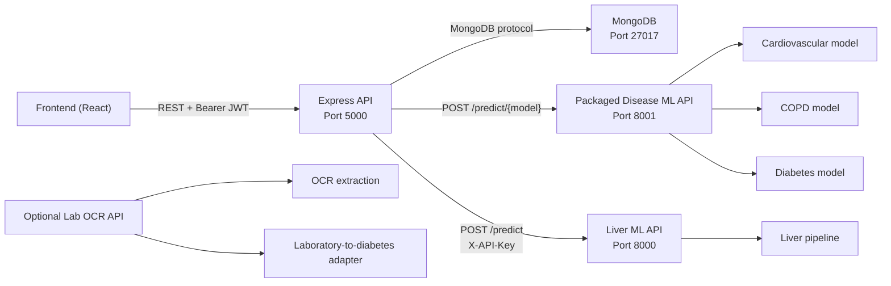
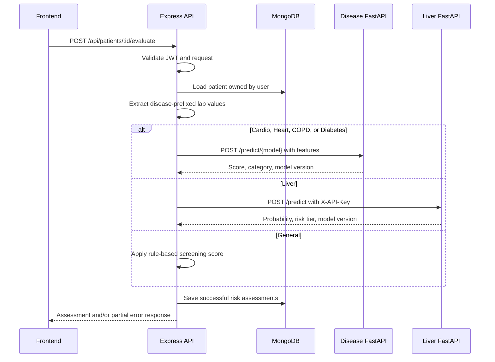

# ProCura Backend and ML System Architecture

This document describes the backend structure, machine-learning components, data flow, runtime services, and deployment boundaries of the ProCura system.

## 1. System Overview

ProCura is a multi-service application consisting of:

1. An Express/Node.js REST API that handles authentication and patient records.
2. MongoDB, which persists users, patients, and risk assessments.
3. A FastAPI service for cardiovascular, COPD, and diabetes screening models.
4. A separate FastAPI service for liver-disease inference.
5. A local liver ML package for training, evaluation, explainability, and serving.
6. An optional lab-report OCR subsystem that extracts and analyzes laboratory reports.



The Express API is the authoritative application backend. The Python services provide model inference; they are not databases or source-of-truth systems.

## 2. Backend File Structure

```text
Backend/
├── .env.example
├── .env                         # Local secrets; never commit
├── package.json
├── README.md
├── SYSTEM_ARCHITECTURE.md
├── src/
│   ├── server.js                # MongoDB connection and HTTP server startup
│   ├── app.js                   # Express middleware, routes, and error handling
│   ├── config/
│   │   └── env.js               # Environment validation
│   ├── middleware/
│   │   └── auth.js              # Bearer JWT authentication
│   ├── models/
│   │   ├── User.js              # Account model and password hashing
│   │   └── Patient.js           # Patient, lab values, and assessments
│   └── routes/
│       ├── auth.js              # Registration, login, current user
│       ├── patients.js           # Patient CRUD
│       ├── risk.js               # Disease evaluation orchestration
│       └── risk.test.js          # Risk-route tests
└── MLAIM/
    ├── procura_ml_api.py         # Cardiovascular/COPD/diabetes FastAPI service
    ├── inference-requirements.txt
    ├── artifacts/                # Packaged trained model bundles
    ├── production/               # Diabetes production inference and lab OCR
    ├── liver_disease/            # Liver disease training and serving project
    ├── tests/                    # Disease inference API tests
    ├── Cardio_*                  # Cardiovascular experiments and packaging
    ├── COPD_*                    # COPD experiments and packaging
    ├── *_main.py                 # Model training/experimentation entry points
    └── experiments/              # Shared experimental code
```

### Express Startup

`src/server.js`:

- Reads validated environment settings.
- Connects to MongoDB using Mongoose.
- Starts the Express server.
- Disconnects MongoDB and closes the server during shutdown.

`src/app.js`:

- Disables the Express `X-Powered-By` header.
- Applies Helmet security headers.
- Configures CORS from `CORS_ORIGIN`.
- Parses JSON request bodies with a 1 MB limit.
- Applies rate limiting to `/api/auth`.
- Registers authentication, patient, and risk routes.
- Converts Zod validation and MongoDB errors into API responses.

## 3. Backend Data Model

### User

The `User` model stores:

- Name
- Lowercase email
- BCrypt password hash
- Role: `patient`, `clinician`, or `admin`
- Creation and update timestamps

Passwords are hashed with `bcryptjs` using cost factor 12. Password hashes are excluded from normal queries.

### Patient

The `Patient` model stores:

- Owning user
- External `patientId`
- Demographics
- Vitals
- Clinical flags
- Disease-prefixed laboratory values
- Historical risk assessments

The `labValues` field is a MongoDB map because each model has a different feature schema. Values use names such as:

- `cardiovascular:age`
- `heart:ap_hi`
- `copd:BMI`
- `diabetes:HighBP`
- `liver:total_bilirubin`

This prevents fields with similar or identical names from being mixed across disease models.

## 4. Authentication and Authorization

Registration and login are exposed through `/api/auth`.

After login or registration, the server creates a JWT containing:

- `sub`: MongoDB user ID
- `role`: account role

Protected patient and evaluation routes require:

```http
Authorization: Bearer <token>
```

The auth middleware verifies the signature and attaches the decoded user to `req.user`. Patient queries and mutations are restricted to the authenticated owner's records.

## 5. REST API Routes

### Authentication

| Method | Endpoint | Purpose |
|---|---|---|
| `POST` | `/api/auth/register` | Create an account |
| `POST` | `/api/auth/login` | Authenticate and issue a JWT |
| `GET` | `/api/auth/me` | Return the current user |

### Patients

| Method | Endpoint | Purpose |
|---|---|---|
| `POST` | `/api/patients` | Create a patient |
| `GET` | `/api/patients` | List the owner's patients |
| `GET` | `/api/patients/:id` | Retrieve one patient |
| `PUT` | `/api/patients/:id` | Replace/update patient fields |
| `DELETE` | `/api/patients/:id` | Delete a patient |

### Risk Evaluation

| Method | Endpoint | Purpose |
|---|---|---|
| `POST` | `/api/patients/:id/evaluate` | Evaluate one or more diseases |

Supported types:

- `cardiovascular`
- `heart`
- `diabetes`
- `liver`
- `copd`
- `general`

`heart` uses the cardiovascular model and cardiovascular input schema.

## 6. Risk Evaluation Architecture



Successful assessments are appended to `riskAssessments` and saved.

For multiple disease types:

- Each disease is evaluated independently.
- Successful results remain in the response.
- Failed evaluations remain in the `errors` array.
- HTTP `207` is returned for a partial success.
- HTTP `201` is returned when every requested type succeeds.
- HTTP `4xx/5xx` is used when no assessment succeeds.

The general screening option uses explicit rules based on diabetes status, hypertension, smoking, BMI, and systolic blood pressure.

## 7. Packaged Disease ML API

The cardiovascular, COPD, and diabetes service is implemented in:

```text
MLAIM/procura_ml_api.py
```

It exposes:

| Method | Endpoint | Model |
|---|---|---|
| `GET` | `/health` | Service status |
| `POST` | `/predict/cardiovascular` | Cardiovascular risk |
| `POST` | `/predict/copd` | COPD risk |
| `POST` | `/predict/diabetes` | Diabetes risk |

At startup, the FastAPI lifespan loads the packaged cardiovascular, COPD, and diabetes model bundles once.

The service validates exact feature sets, coded integer fields, binary fields, ranges, and finite numeric values.

### Cardiovascular Model

- Artifact: `MLAIM/artifacts/cardio_risk_model.joblib`
- Training and packaging: `Cardio_*.py`
- Input: age, sex, height, weight, blood pressure, cholesterol, glucose, smoking, alcohol, and activity

### COPD Model

- Artifact: `MLAIM/artifacts/copd_risk_model.joblib`
- Training and packaging: `COPD_*.py`
- Input: age band, sex, BMI, smoking status, exercise, and general health

### Diabetes Model

- Artifact: `MLAIM/artifacts/diabetes_risk_model.joblib`
- Production implementation: `MLAIM/production/predict.py`
- Input: 21 CDC/BRFSS survey fields

The diabetes predictor supports a calibrated LightGBM risk score, risk levels, recommendations, and top feature contributions.

## 8. Liver Disease ML Project

The liver project is a complete subproject:

```text
MLAIM/liver_disease/
├── src/liver_disease/
│   ├── api/                     # FastAPI entrypoint, routes, schemas, auth
│   ├── data/                    # Loading, normalization, and validation
│   ├── features/                # Clinical feature engineering
│   ├── models/                  # Training, prediction, evaluation, explanation
│   ├── utils/                   # Logging and I/O
│   └── config.py                # Paths and feature definitions
├── data/
│   ├── raw/                     # Original ILPD data
│   └── processed/               # Locked training and test sets
├── artifacts/
│   ├── models/                  # Serialized model pipeline
│   └── reports/                 # Benchmark and evaluation reports
├── notebooks/                   # Executed modeling notebooks
├── scripts/                     # Reproducible pipeline operations
├── tests/                       # Data, model, API, prediction, and security tests
├── frontend/                    # Standalone Streamlit prototype
└── docs/                        # API and architecture documentation
```

### Liver API

The liver service is created by `src/liver_disease/api/main.py`. It loads `artifacts/models/liver_disease_pipeline.joblib` during startup and never retrains at startup.

| Method | Endpoint | Purpose |
|---|---|---|
| `GET` | `/health` | API and model readiness |
| `GET` | `/model-info` | Feature schema and model metadata |
| `POST` | `/predict` | Single patient prediction |
| `POST` | `/predict/batch` | CSV batch prediction |
| `POST` | `/explain` | Prediction plus SHAP explanation |

All metadata and inference routes require `X-API-Key`. The key is read from `LIVER_API_KEY` and compared using constant-time verification.

The predictor:

1. Normalizes canonical API fields.
2. Validates the 10-feature ILPD schema.
3. Runs the serialized preprocessing and voting pipeline.
4. Applies the stored decision threshold.
5. Maps probability to Low, Moderate, or High.
6. Adds a model version and medical disclaimer.

The `/explain` route initializes SHAP from the serialized background data and returns top feature attributions.

## 9. Optional Lab-Report OCR Subsystem

The optional OCR subsystem is under:

```text
MLAIM/production/lab_ocr/
```

It provides a separate FastAPI application that can:

- Extract lab values from PDFs or images.
- Display and review extracted values.
- Convert laboratory values into a laboratory/clinical assessment.
- Adapt selected values to the diabetes feature set.
- Export reviewed results as JSON or CSV.
- Provide optional rule-based or AI-generated advice.

Key layers include:

- `file_validator.py`: file type and size validation
- `pdf_processor.py`: PDF extraction
- `image_processor.py`: image processing
- `ocr_engine.py`: OCR execution
- `medical_extractor.py`: lab-test extraction
- `lab_ocr/service.py`: extraction workflow orchestration
- `lab_ocr/api.py`: HTTP and static web interface
- `lab_ocr/prediction/`: model-spec loading and report prediction

This subsystem is separate from the Express patient evaluation flow unless explicitly integrated by a future API route.

## 10. Runtime Services

| Service | Technology | Default port | Purpose |
|---|---|---|---|
| Frontend | React/Vite | `5173` | User interface |
| Express API | Node.js/Express | `5000` | Auth, patients, orchestration |
| MongoDB | MongoDB | `27017` | Persistent application data |
| Disease ML API | Python/FastAPI | `8001` | Cardiovascular/COPD/diabetes |
| Liver ML API | Python/FastAPI | `8000` | Liver inference |
| Lab OCR API | Python/FastAPI | configurable | Optional lab report analysis |

## 11. Environment Configuration

### Express

The main backend settings are in `Backend/.env` and `Backend/.env.example`:

- `PORT`
- `NODE_ENV`
- `MONGO_URI`
- `MONGO_DB`
- `JWT_SECRET`
- `JWT_EXPIRES_IN`
- `CORS_ORIGIN`
- `LIVER_ML_API_URL`
- `LIVER_ML_API_KEY`
- `DISEASE_ML_API_URL`

### Liver API

Important liver settings include:

- `LIVER_API_KEY`
- `MODEL_ARTIFACT_PATH`
- `MAX_BATCH_ROWS`
- `CORS_ALLOWED_ORIGINS`
- `LOG_LEVEL`

## 12. Local Startup

Start MongoDB locally on port `27017`.

Start the Express API:

```powershell
cd Backend
npm run dev
```

Start the packaged disease service:

```powershell
cd Backend\MLAIM
python -m uvicorn procura_ml_api:app --host 127.0.0.1 --port 8001
```

Start the liver service:

```powershell
cd Backend\MLAIM\liver_disease
$env:PYTHONPATH="src"
$env:LIVER_API_KEY="your-local-api-key"
python -m uvicorn liver_disease.api.main:app --host 127.0.0.1 --port 8000
```

Start the optional liver Streamlit prototype:

```powershell
cd Backend\MLAIM\liver_disease
$env:API_BASE_URL="http://127.0.0.1:8000"
$env:LIVER_API_KEY="your-local-api-key"
python -m streamlit run frontend\app.py --server.port 8501
```

## 13. Testing

Express and route tests:

```powershell
cd Backend
npm test
```

Packaged disease ML tests:

```powershell
cd Backend\MLAIM
python -m pytest tests -v
```

Liver ML tests:

```powershell
cd Backend\MLAIM\liver_disease
python -m pytest tests -v
```

## 14. Architectural Boundaries

- The frontend never calculates disease predictions.
- MongoDB is the source of truth for application accounts and patient records.
- Express is the integration and authorization layer.
- ML services receive features and return screening results.
- Model bundles are loaded into memory and are not retrained on every request.
- Assessment results are persisted only after successful patient evaluation.
- External ML outputs are validated before being returned or saved.
- These services provide screening support and are not diagnostic medical devices.
